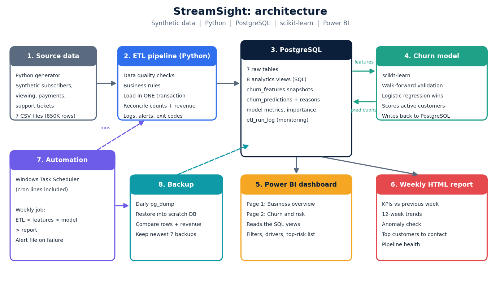
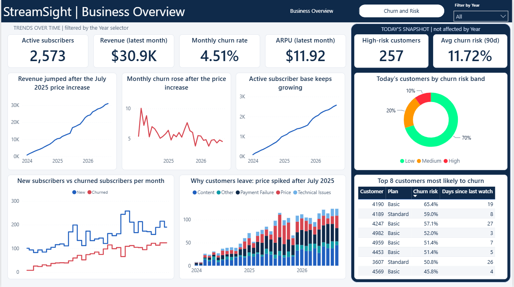
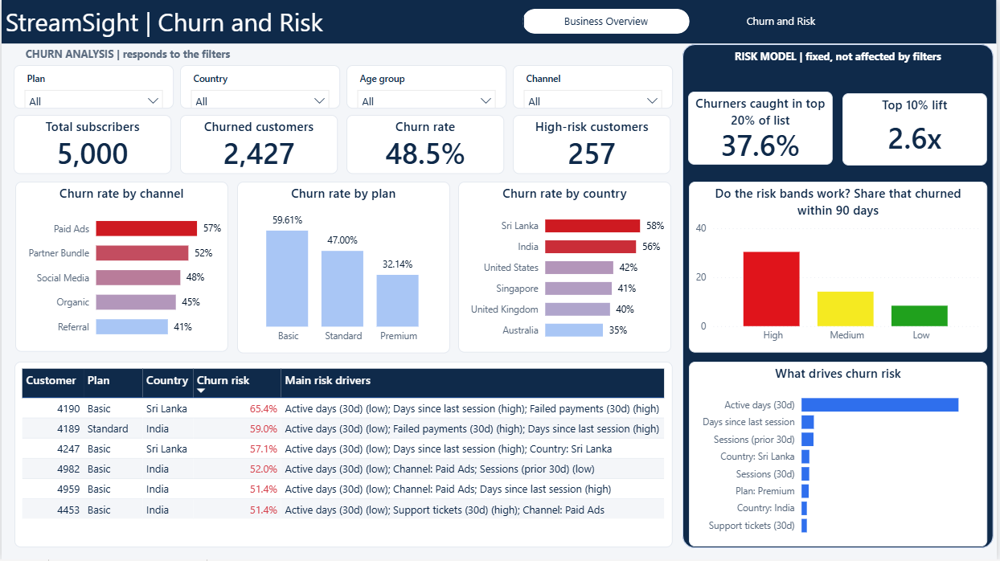
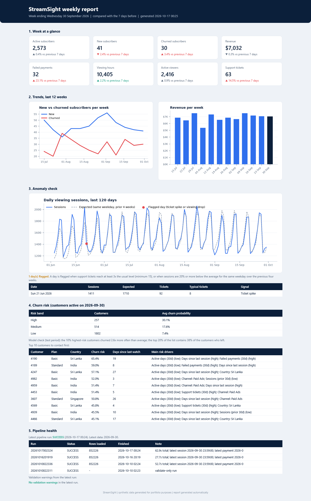

# StreamSight: Subscription Analytics Platform

An end-to-end analytics project for a Netflix-style streaming service. It covers the full path from raw data to decisions: a Python ETL pipeline, a PostgreSQL reporting database, SQL analytics views, a churn prediction model, a Power BI dashboard, an automated weekly report, and a backup job that proves it can restore itself.

> **Data note:** real subscriber data is not public, so all data in this project is **synthetic**. I generated it myself and built realistic patterns into it on purpose (seasonality, evening viewing peaks, a price increase, outage days, churn drivers). The patterns are checked by a validation script. No real people, companies or systems are involved.



## What it does

| Area | What I built |
|---|---|
| **Data** | A generator for 5,000 subscribers, 600 titles, about 795,000 viewing sessions, 46,000 payments and 5,000 support tickets (Jan 2024 to Sep 2026) |
| **ETL** | Python pipeline that validates, loads and reconciles 852,000 rows into PostgreSQL in about one minute, with logging and alerts |
| **Analytics layer** | 8 SQL views for dashboards, plus a snapshot based feature table for machine learning |
| **Churn model** | Logistic regression trained with walk-forward validation, scoring today's customers and explaining each score |
| **Dashboard** | Two page Power BI report: business overview and churn risk |
| **Automation** | Weekly job (ETL, features, model, report) with a scheduler, and a daily backup with an automatic restore test |

## Key results

- **Churn model:** the 10% of customers flagged as highest risk churned **2.6 times** more often than average. In the test period, customers in the High risk band churned **30%** of the time, Medium **14%**, Low **8%**. The top 20% of the risk list contained 38% of the customers who left.
- **Strongest churn signal:** how many days a customer watched in the last 30 days. Customers who stop watching regularly are the ones who leave.
- **Price increase (July 2025):** monthly revenue rose from about $13.5K in June to $16.9K in July, while monthly churn rose from 5.2% in June to 7.7% in August. "Price" was the reason for 39% of cancellations from July to October 2025, against 18% in other months.
- **Plan matters:** 60% of Basic plan subscribers have churned, against 47% on Standard and 32% on Premium.

## Tech stack

Python (pandas, NumPy, scikit-learn, SQLAlchemy, psycopg2, matplotlib) | PostgreSQL | SQL (views, window functions, lateral joins) | Power BI | Windows Task Scheduler (Linux cron lines included) | Git

## How it works

### 1. Synthetic data that behaves like real data
Flat random data would make every chart look the same, so the generator builds in real patterns: signups that grow with seasonality and promotions, churn that is highest in the first months and depends on plan, channel, country and engagement, evening and weekend viewing peaks that differ by device, genre taste that differs by age group, higher payment failures in some countries, and four outage days. `validate_data.py` runs 12 integrity checks and prints the analytics so the patterns can be checked by eye. This validation caught four problems in my first version.

### 2. ETL pipeline
`etl/etl_pipeline.py` follows extract, validate, load, verify:
- **Validate before loading:** columns, nulls, duplicate IDs, allowed values, negative amounts, dates, orphan records, and cross-table business rules (for example, no viewing after a subscriber has churned).
- **Load in one transaction:** all tables load together or not at all, so a failed run never leaves half loaded data. The run is repeatable.
- **Reconcile:** row counts, total revenue and churned counts must match the source files.
- **Monitor:** every step is written to a log file and to the `etl_run_log` table. A failure creates an alert file and returns exit code 1, so a scheduler can detect it.

### 3. Analytics layer
`sql/analytics_views.sql` creates views for monthly KPIs, engagement, content performance, genre taste by age, churn reasons and daily activity. Power BI reads these views instead of raw tables, so the logic lives in one place.

### 4. Churn model
- **Snapshots:** the feature table has one row per active customer per snapshot date (five snapshots). Every feature uses only data up to that date. The label is "did this customer leave in the next 90 days?".
- **No data leakage:** cancellation reason, status and churn date are deliberately not used as features.
- **Walk-forward validation:** models are chosen by training on earlier snapshots and validating on a later one, then scored on an even later test snapshot that is never used for choosing. Logistic regression, random forest and gradient boosting were compared, and the simple logistic regression won on validation.
- **Honest accuracy:** test AUC is about 0.68. That is a realistic level for churn, and it matters more that the risk bands separate customers clearly (30% / 14% / 8%).
- **Explainable:** each customer gets their top three risk drivers, for example "Active days (low); Days since last session (high); Failed payments (high)".
- **Written back to the database:** predictions, metrics and feature importance are stored in PostgreSQL, and Power BI reads them from there.

### 5. Dashboard
Two pages share one layout: a filterable area on the left and a fixed risk model area on the right.

| Page | Content |
|---|---|
| **Business Overview** | KPIs, revenue, churn rate, active subscribers, new vs churned, reasons for leaving, risk bands, top customers at risk, year filter |
| **Churn and Risk** | Filters for plan, country, age group and channel; churn rate by plan, channel and country; reasons for leaving; customers most at risk and why; model results |




### 6. Automation
- `reporting/run_weekly_job.py` runs four steps in order: ETL, rebuild the churn features, retrain and score the model, build the report. It stops at the first failure and writes an alert file.
- `reporting/weekly_report.py` builds a self-contained HTML report: key numbers against the previous week, 12-week trends, an anomaly check (support ticket spikes and viewing drops), the top customers to contact first, and pipeline health. See `docs/sample_weekly_report.html`.
- The job is scheduled with Windows Task Scheduler (`run_weekly_job.bat`). Linux launchers and cron lines are included (`run_weekly_job.sh`, `run_backup.sh`).



### 7. Backup with a restore test
`backup/backup_database.py` dumps the database, restores it into a scratch database, and compares every table and view (row counts) plus a revenue checksum with the live data. Old backups are deleted only after the test passes. A backup that was never restored is only a hope.

## Project structure

```
streamsight/
  etl/              generate_data.py, validate_data.py, etl_pipeline.py, run_sql.py
  sql/              schema.sql, analytics_views.sql, churn_features.sql, dashboard_helpers.sql
  ml/               train_churn_model.py
  reporting/        weekly_report.py, run_weekly_job.py
  backup/           backup_database.py
  dashboard/        StreamSight.pbix, streamsight_theme_v3.json
  docs/             architecture.png, screenshots, sample_weekly_report.html
  run_weekly_job.bat / .sh     run_backup.bat / .sh
  requirements.txt  .env.example
```

## How to run it

1. Install Python 3.10 or newer and PostgreSQL. Create a virtual environment and run `pip install -r requirements.txt`.
2. Copy `.env.example` to `.env` and fill in your PostgreSQL password. Create an empty database named `streamsight`.
3. Create the tables: run `sql/schema.sql` in pgAdmin.
4. Generate and check the data: `python etl/generate_data.py`, then `python etl/validate_data.py`.
5. Load it: `python etl/etl_pipeline.py`.
6. Create the views and features: run `sql/analytics_views.sql` in pgAdmin, then `python etl/run_sql.py sql/churn_features.sql`.
7. Train and score: `python ml/train_churn_model.py`, then run `sql/dashboard_helpers.sql` in pgAdmin.
8. Open `dashboard/StreamSight.pbix` in Power BI Desktop and refresh. Or run `python reporting/run_weekly_job.py` to do steps 5 to 7 and the report in one go.
9. Run `python backup/backup_database.py` to test backup and restore.

## Failure scenarios I tested

| Scenario | Result |
|---|---|
| Duplicate ID, orphan record and negative amount in the source files | Rejected before loading. Nothing loaded, alert written |
| A value PostgreSQL rejects (text too long) | Transaction rolled back, previous data intact |
| Missing source file | Detected, run stopped |
| Re-running the load | Same result (repeatable) |
| Corrupted backup file | Rejected, alert written |
| Backup that differs from the live database | Restore test fails |
| A step in the weekly job fails | Job stops, alert file written, exit code 1 |

Testing also found two real bugs: a misleading engagement feature for new customers (fixed), and a feature rebuild that failed once a dashboard view depended on the table (fixed).

## Limitations and next steps

- All data is synthetic, and the same files are reloaded on every run (full refresh). A real system would load new or changed rows from a source database.
- A test AUC of 0.68 is modest. A real company would add richer features and keep monitoring the model after launch.
- Backups are stored on the same computer. A real setup would copy them off-site.
- The weekly report is saved as a file. Email delivery and a Power BI scheduled refresh would be natural additions.
- Next steps I would take: incremental loads, an API for integrations, and an orchestrator such as Airflow.

## Author

Rishitha | BSc Data Science, Cardiff Metropolitan University (ICBT Campus, Sri Lanka)
